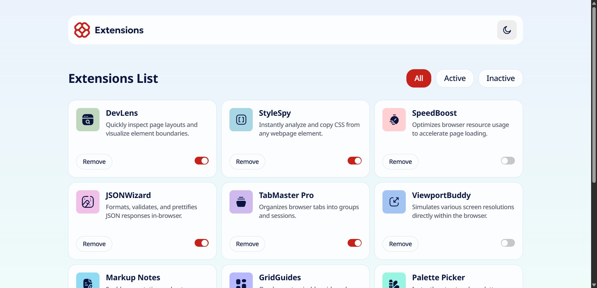
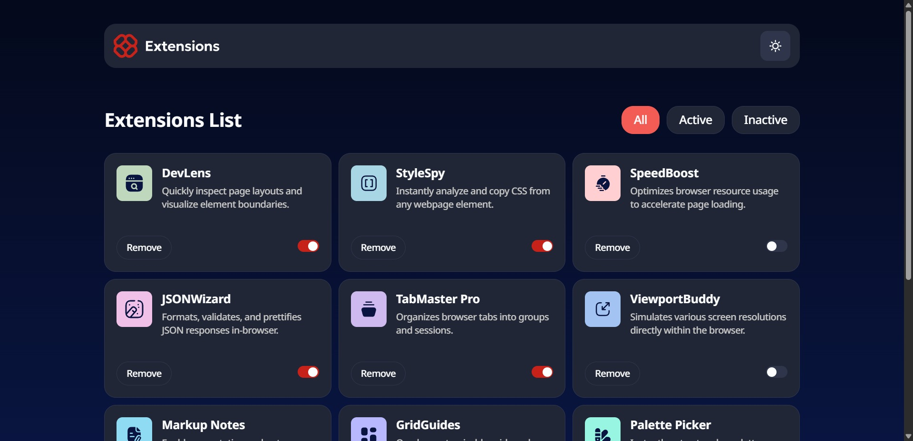

# Frontend Mentor - Browser extensions manager UI solution

This is a solution to the [Browser extensions manager UI challenge on Frontend Mentor](https://www.frontendmentor.io/challenges/browser-extension-manager-ui-yNZnOfsMAp).

## Table of contents

- [Overview](#overview)
  - [The challenge](#the-challenge)
  - [Screenshot](#screenshot)
  - [Links](#links)
- [My process](#my-process)
  - [Built with](#built-with)
  - [What I learned](#what-i-learned)
  - [Continued development](#continued-development)
  - [Useful resources](#useful-resources)
- [AI Collaboration](#ai-collaboration)
- [Author](#author)

## Overview

A browser extensions manager built with vanilla JavaScript, SCSS, and Vite.
Users can toggle extensions on/off, filter by state, remove items, and switch
between light and dark themes. The interface is fully responsive and follows
WCAG 2.2 AA accessibility guidelines.

### The challenge

Users should be able to:

- Toggle extensions between active and inactive states
- Filter active and inactive extensions
- Remove extensions from the list
- Select their color theme
- View the optimal layout for the interface depending on their device's screen size
- See hover and focus states for all interactive elements on the page

### Screenshot

| Light                                  | Dark                                 |
| -------------------------------------- | ------------------------------------ |
|  |  |

### Links

- Solution URL: [GitHub](https://github.com/runny-life/browser-extensions-manager-ui)
- Live Site URL: [Vercel](https://browser-extensions-manager-ui-liart.vercel.app/)

## My process

### Built with

- **Semantic HTML5** — `<article>`, `<fieldset>`, `<legend>`, `<label>` for native semantics
- **SCSS** with `@use` (no deprecated `@import`) and feature-sliced architecture
- **CSS custom properties** for two-tier theming (palette → semantic tokens)
- **CSS Grid** — intrinsic `auto-fill` + `minmax` for the card layout, `1fr auto` rows for cards
- **Flexbox** for component-level layouts
- **Vanilla JavaScript** (ES modules, no framework) with a simple observable store
- **Vite 8** as build tool with `sass-embedded`
- **Mobile-first workflow** with breakpoints at 768px and 1024px
- **WCAG 2.2 AA** — native radio group, ARIA `switch`, `:focus-visible`, `.visually-hidden`

### What I learned

**1. Two-tier design tokens scale better than a flat palette.**
Instead of using `$neutral-900` everywhere, I split tokens into two layers:
raw palette (`$neutral-900`, `$red-400`) and semantic roles (`--color-text-primary`,
`--color-bg-accent`). When the dark theme needed a different accent (red-400 instead
of red-700 for contrast), I only changed one semantic token — no component had to change.

```scss
:root {
  --color-bg-accent: #{$red-700};
}
[data-theme='dark'] {
  --color-bg-accent: #{$red-400};
}
```

**2. Native `<input type="radio">` inside `<fieldset>` is better than styled buttons.**
My first instinct for the filter bar was `<button>` with `aria-pressed`.
But native radios give keyboard arrow navigation, "exactly one selected" semantics,
and correct screen reader announcements for free. I only had to style the sibling
`<span>` with `input:checked + span` — no JavaScript logic for selection.

**3. `@use` in SCSS is not just a rename of `@import`.**
`@import` loads files into the global namespace — variables leak everywhere,
and the same file can be loaded twice. `@use` makes each file declare its own
dependencies explicitly. It took me a while to understand that `base/_globals.scss`
must write `@use '../abstracts' as *;` on its own — not rely on `main.scss` doing it.

**4. Hiding a checkbox with `display: none` breaks accessibility.**
For the custom toggle, I initially wanted `display: none` on the `<input>`.
But that removes it from the tab order and from screen reader output.
The correct pattern is `.visually-hidden` — the element is invisible but still focusable:

```scss
@mixin visually-hidden {
  position: absolute;
  width: 1px;
  height: 1px;
  margin: -1px;
  overflow: hidden;
  clip-path: inset(50%);
  white-space: nowrap;
  border: 0;
}
```

**5. DOM properties are case-sensitive — and TypeScript would have caught my typo.**
I spent 20 minutes debugging why the list duplicated instead of being replaced.
The culprit was `container.innerHtml = ''` instead of `container.innerHTML = ''`.
JavaScript created a new "shadow" property that did nothing. In TypeScript,
this would be a compile-time error. A good reminder that type systems pay off.

**6. Preventing FOUC in theme switching requires a synchronous inline script.**
The `main.js` module runs deferred — after HTML parsing. So if the user's saved
theme is dark, they would briefly see the light theme before JS kicks in.
The fix is a small inline script in `<head>` that sets `data-theme` before
the browser paints:

```html
<script>
  (function () {
    const saved = localStorage.getItem('theme');
    const prefersDark = matchMedia('(prefers-color-scheme: dark)').matches;
    document.documentElement.dataset.theme = saved || (prefersDark ? 'dark' : 'light');
  })();
</script>
```

### Continued development

Things I'd like to improve in this project:

- **Empty state for filters.** If the user selects "Active" but has no active
  extensions, the list is just empty. A proper message ("No active extensions")
  would be better UX.
- **Persist extension state to `localStorage`.** Currently toggling or removing
  resets on reload. A real extension manager would save state.
- **Remove animation.** When a card is removed, it disappears abruptly. A fade-out
  or collapse animation would feel smoother.
- **Container queries for cards.** The card currently adapts via `minmax` on the grid,
  but true container queries would let it reflow based on its own width — useful
  if the card is ever reused in a sidebar.
- **Unit tests.** No tests currently. I'd add Vitest for `state.js` and pure functions.

### Useful resources

- [A more modern CSS reset — Andy Bell](https://piccalil.li/blog/a-more-modern-css-reset/) —
  the basis for my `_reset.scss`. Explains _why_ each rule exists.
- [Inclusive Components — Heydon Pickering](https://inclusive-components.design/) —
  patterns for accessible toggles and tab-like controls.
- [web.dev: `prefers-color-scheme`](https://web.dev/prefers-color-scheme/) —
  guide on theme detection and FOUC prevention.
- [MDN: CSS Custom Properties](https://developer.mozilla.org/en-US/docs/Web/CSS/Using_CSS_custom_properties) —
  reference I came back to many times while building the theming system.
- [Every Layout](https://every-layout.dev/) — helped me decide when to use Grid vs Flexbox.

## AI Collaboration

I used Claude (Anthropic) as a learning assistant throughout this project.
The code is written by me — Claude acted as a reviewer, explainer, and pairing partner.

**How I used it:**

- **Architecture decisions.** We discussed trade-offs between plain JS, React,
  and Feature-Sliced Design before writing any code. I made the final call,
  but the conversation clarified _why_ FSD makes sense for medium projects.
- **Code review after each step.** After every feature, I shared my code and
  asked for critique. Claude consistently flagged accessibility issues I missed —
  for example, that `<button>` without `type="button"` behaves as submit inside forms,
  or that `display: none` on a checkbox breaks keyboard focus.
- **Debugging with explanations.** When I hit the `innerHtml` vs `innerHTML` bug,
  Claude explained _why_ it happened (case-sensitive DOM properties) rather than
  just providing a fix. That's how I actually learned.
- **Not used for:** writing the full solution. Every line was written by me.
  Where I got stuck, I asked for hints or conceptual explanations, then implemented
  it myself.

**What worked well:** explaining the _why_ behind patterns — I now understand
two-tier tokens, `.visually-hidden`, and FOUC prevention, not just how to copy them.

**What didn't:** sometimes the suggested code was more complex than necessary
(e.g., over-engineered store patterns). I learned to simplify and question complexity.

## Author

- GitHub - [@YOUR_USERNAME](https://github.com/runny-life)
- Frontend Mentor - [@YOUR_USERNAME](https://www.frontendmentor.io/profile/runny-life)

## Acknowledgments

Thanks to the Frontend Mentor community for the challenge and feedback.
Special thanks to the authors of "Every Layout" and "Inclusive Components" —
their patterns shaped how I think about layout and accessibility.
